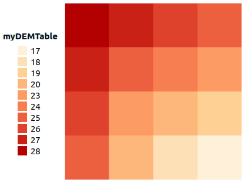

# ASCRead

## Signatures

```sql
ASCRead(VARCHAR path);
ASCRead(VARCHAR path, BOOLEAN deleteTable);

ASCRead(VARCHAR path, VARCHAR myTable);
ASCRead(VARCHAR path, VARCHAR myTable, BOOLEAN deleteTable);

ASCRead(VARCHAR path, INTEGER type);
ASCRead(VARCHAR path, VARCHAR myTable, INTEGER type);

ASCRead(VARCHAR path, VARCHAR myTable, GEOMETRY geomFilter, 
        INTEGER downScaleInt, BOOLEAN asPolygons);
ASCRead(VARCHAR path, VARCHAR myTable, GEOMETRY geomFilter, 
        INTEGER downScaleInt, BOOLEAN asPolygons, BOOLEAN deleteTable);
ASCRead(VARCHAR path, VARCHAR myTable, GEOMETRY geomFilter, 
        INTEGER downScaleInt, BOOLEAN asPolygons, BOOLEAN deleteTable,
        VARCHAR encoding, INTEGER type);
ASCRead(VARCHAR path, VARCHAR myTable, GEOMETRY geomFilter, 
        INTEGER downScaleInt, BOOLEAN asPolygons, BOOLEAN deleteTable,
        VARCHAR encoding, INTEGER type, BOOLEAN importNodata);
```

## Description

Import Esri ASCII Raster file as `POINT` or `POLYGON` geometries.

Pixels are converted into `PointZ` (or `PolygonZ`) geometry with Z as the pixel value (stored as `DOUBLE` by default). The cells equal to the `NODATA_value` of the file are not imported, unless `importNodata` is `true`.

Where:

- `path` : adress of the `.asc` file. This file may be zipped in a `.gz` file *(in this case, the `ASCRead` driver will unzip on the fly the `.gz` file)*,
- `myTable` : name of the output table,
- `type` : indicates whether the `z` data type will be casted to INTEGER (`1`) or left as DOUBLE (`2` - default value),
- `geomFilter` : extract only pixels that intersects the provided geometry envelope (`null` or empty argument to disable filter),
- `downScaleInt` : a coefficient used for exporting less cells (`1` all cells, `2` for size / 2, ...),
- `asPolygons` : if `true`, pixels are converted into polygons (default value = `false` return points),
- `encoding` : encoding of the `.asc` file (`null` for `UTF-8`, the default value),
- `importNodata` : if `true`, the cells equal to the `NODATA_value` are imported, with the `NODATA_value` as Z (default value = `false`, these cells are ignored). With `type` = `1`, the `NODATA_value` must be an integer, otherwise an error is thrown before the import,
- `deleteTable` : if `true` and table `tableName` already exists in the database, then table `tableName` will be removed / replaced by the new one. Else (no `deleteTable` parameter or `deleteTable` equal to `false`), throw an exception if the `tableName` already exist.

## Examples

We assume that we have the following `.asc` file, named `dem` and placed here: `/home/user/`.

```java
ncols        4
nrows        4
xllcorner    10
yllcorner    10
cellsize     5.0
NODATA_value  -9999
 28 27 26 25
 27 25 24 23
 26 23 20 19
 25 20 18 17
```


### 1. Using the `path`

```sql
CALL ASCREAD('/home/user/dem.asc');
```

Returns the table `dem`, with the following values:

|   PK  | THE_GEOM |  Z  |
|:-----:|:--------:|:---:|
| 1 |    POINT Z (12.5 27.5 28)   | 28.0 |
| 2 |    POINT Z (17.5 27.5 27)   | 27.0 |
| 3 |    POINT Z (22.5 27.5 26)   | 26.0 |
| 4 |    POINT Z (27.5 27.5 25)   | 25.0 |
| 5 |    POINT Z (12.5 22.5 27)   | 27.0 |
| 6 |    POINT Z (17.5 22.5 25)   | 25.0 |
| 7 |    POINT Z (22.5 22.5 24)   | 24.0 |
| 8 |    POINT Z (27.5 22.5 23)   | 23.0 |
| 9 |    POINT Z (12.5 17.5 26)   | 26.0 |
| 10 |    POINT Z (17.5 17.5 23)   | 23.0 |
| 11 |    POINT Z (22.5 17.5 20)   | 20.0 |
| 12 |    POINT Z (27.5 17.5 19)   | 19.0 |
| 13 |    POINT Z (12.5 12.5 25)   | 25.0 |
| 14 |    POINT Z (17.5 12.5 20)   | 20.0 |
| 15 |    POINT Z (22.5 12.5 18)   | 18.0 |
| 16 |    POINT Z (27.5 12.5 17)   | 17.0 |

**Remark**: If the `dem.asc` has been zipped into a `.gz` file, execute the following instruction:

```sql
CALL ASCREAD('/home/user/dem.asc.gz');
```

In this case, since the `myTable` parameter has not been specified, the resuling table will be named `DEM_ASC`.

### 2. Using `myTable`

```sql
CALL ASCREAD('/home/user/dem.asc', 'myDEMTable');
```

Returns the table `myDEMTable` (same as `dem` table)

|   PK  | THE_GEOM |  Z  |
|:-----:|:--------:|:---:|
| 1 |    POINT Z (12.5 27.5 28)   | 28.0 |
| 2 |    POINT Z (17.5 27.5 27)   | 27.0 |
| ... |    ...   | ... |


### 3. Using `type`

Here we want to convert Z value into INTEGER
```sql
CALL ASCREAD('/home/user/dem.asc', 1);
```

Returns the table `dem`

|   PK  | THE_GEOM |  Z  |
|:-----:|:--------:|:---:|
| 1 |    POINT Z (12.5 27.5 28)   | 28 |
| 2 |    POINT Z (17.5 27.5 27)   | 27 |
| ... |    ...   | ... |


### 4. Using `geomFilter`
Here, we want to keep only `POINT`s that intersect this geometry: `POLYGON((15 15, 15 25, 25 25, 25 15, 15 15))`

```sql
CALL ASCREAD(
  '/home/user/dem.asc', 
  'myDEMTable', 
  ST_GeomFromText('POLYGON((15 15, 15 25, 25 25, 25 15, 15 15))'),
  1, false);
```

Returns the table `myDEMTable`, with the following values:

| PK   |       THE_GEOM         | Z   |
|:----:|:----------------------:|:---:|
| 1    | POINT Z (17.5 22.5 25) | 25.0  |
| 2    | POINT Z (22.5 22.5 24) | 24.0  |
| 3    | POINT Z (27.5 22.5 23) | 23.0  |
| 4    | POINT Z (17.5 17.5 23) | 23.0  |
| 5    | POINT Z (22.5 17.5 20) | 20.0  |
| 6    | POINT Z (27.5 17.5 19) | 19.0  |
| 7    | POINT Z (17.5 12.5 20) | 20.0  |
| 8    | POINT Z (22.5 12.5 18) | 18.0  |
| 9    | POINT Z (27.5 12.5 17) | 17.0  |


### 5. Using `downScaleInt`

Here we want to divide the matrix size by 2

```sql
CALL ASCREAD('/home/user/dem.asc', 'myDEMTable', null, 2, false);
```

Returns the table `myDEMTable`, with the following values:

| PK   |       THE_GEOM         | Z   |
|:----:|:----------------------:|:---:|
| 1    | POINT Z (12.5 27.5 28) | 28.0  |
| 2    | POINT Z (22.5 27.5 26) | 26.0  |
| 3    | POINT Z (12.5 17.5 26) | 26.0  |
| 4    | POINT Z (22.5 17.5 20) | 20.0  |


### 6. Using `asPolygons`

Here we want to have a resulting `POLYGON` layer.

```sql
CALL ASCREAD('/home/user/dem.asc', 'myDEMTable', null, 1, true);
```

Returns the table `myDEMTable`, with the following values:

{align=center}


| PK   |                           THE_GEOM                             | Z   |
|:----:|:--------------------------------------------------------------:|:---:|
|   1  | POLYGON Z ((10 30 28, 10 25 28, 15 25 28, 15 30 28, 10 30 28)) |  28.0 |
|   2  | POLYGON Z ((15 30 27, 15 25 27, 20 25 27, 20 30 27, 15 30 27)) |  27.0 |
|   3  | POLYGON Z ((20 30 26, 20 25 26, 25 25 26, 25 30 26, 20 30 26)) |  26.0 |
|   4  | POLYGON Z ((25 30 25, 25 25 25, 30 25 25, 30 30 25, 25 30 25)) |  25.0 |
|   5  | POLYGON Z ((10 25 27, 10 20 27, 15 20 27, 15 25 27, 10 25 27)) |  27.0 |
|   6  | POLYGON Z ((15 25 25, 15 20 25, 20 20 25, 20 25 25, 15 25 25)) |  25.0 |
|   7  | POLYGON Z ((20 25 24, 20 20 24, 25 20 24, 25 25 24, 20 25 24)) |  24.0 |
|   8  | POLYGON Z ((25 25 23, 25 20 23, 30 20 23, 30 25 23, 25 25 23)) |  23.0 |
|   9  | POLYGON Z ((10 20 26, 10 15 26, 15 15 26, 15 20 26, 10 20 26)) |  26.0 |
|  10  | POLYGON Z ((15 20 23, 15 15 23, 20 15 23, 20 20 23, 15 20 23)) |  23.0 |
|  11  | POLYGON Z ((20 20 20, 20 15 20, 25 15 20, 25 20 20, 20 20 20)) |  20.0 |
|  12  | POLYGON Z ((25 20 19, 25 15 19, 30 15 19, 30 20 19, 25 20 19)) |  19.0 |
|  13  | POLYGON Z ((10 15 25, 10 10 25, 15 10 25, 15 15 25, 10 15 25)) |  25.0 |
|  14  | POLYGON Z ((15 15 20, 15 10 20, 20 10 20, 20 15 20, 15 15 20)) |  20.0 |
|  15  | POLYGON Z ((20 15 18, 20 10 18, 25 10 18, 25 15 18, 20 15 18)) |  18.0 |
|  16  | POLYGON Z ((25 15 17, 25 10 17, 30 10 17, 30 15 17, 25 15 17)) |  17.0 |


### 7. Using `importNodata`

We want to read the following `.asc` file, named `dem_nodata`.

```java
ncols        2
nrows        2
xllcorner    0
yllcorner    0
cellsize     1
NODATA_value -9999
 1 2
 3 -9999
```

By default, the nodata cell is not imported:

```sql
CALL ASCREAD('/home/user/dem_nodata.asc', 'myDEMTable');
```

| PK   |       THE_GEOM        | Z   |
|:----:|:---------------------:|:---:|
| 1    | POINT Z (0.5 1.5 1)   | 1.0 |
| 2    | POINT Z (1.5 1.5 2)   | 2.0 |
| 3    | POINT Z (0.5 0.5 3)   | 3.0 |

Here we want to import the nodata cell, with Z as INTEGER:

```sql
CALL ASCREAD('/home/user/dem_nodata.asc', 'myDEMTable', null, 1, false, true, 'UTF-8', 1, true);
```

| PK   |        THE_GEOM          | Z     |
|:----:|:------------------------:|:-----:|
| 1    | POINT Z (0.5 1.5 1)      | 1     |
| 2    | POINT Z (1.5 1.5 2)      | 2     |
| 3    | POINT Z (0.5 0.5 3)      | 3     |
| 4    | POINT Z (1.5 0.5 -9999)  | -9999 |

**Remark**: If the `NODATA_value` is a decimal value (e.g. `-3.4e38`), use `type` = `2` to import the nodata cells.

## See also

* [`CSVRead`](../CSVRead)
* <a href="https://github.com/orbisgis/h2gis/blob/master/h2gis-functions/src/main/java/org/h2gis/functions/io/asc/AscRead.java"
  target="_blank">Source code</a>