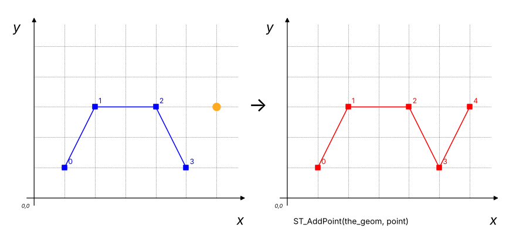
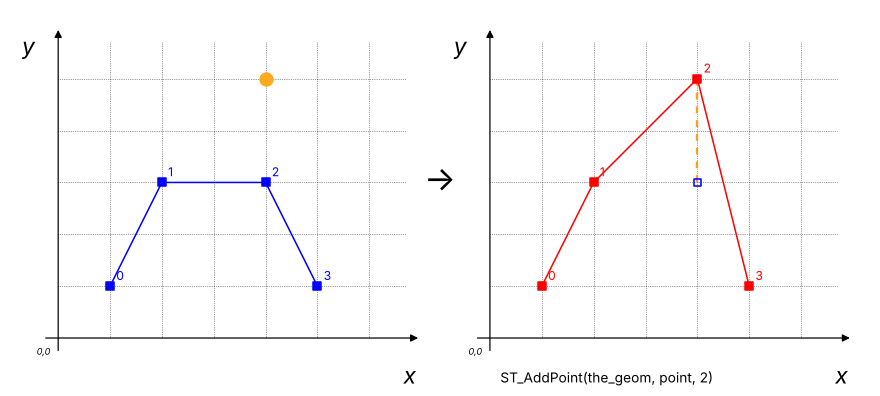

# ST_AddPoint

## Signatures

```sql
the_geomETRY ST_AddPoint(the_geomETRY the_geom, POINT point);
the_geomETRY ST_AddPoint(the_geomETRY the_geom, POINT point, INTEGER index);
```

## Description

Adds `point` to the `LINESTRING` `the_geom`.

* Without `index`, `point` is appended at the end of `the_geom`.
* With `index` (0-based), `point` replaces the vertex at this position. If `index` is equal to the number of points of `the_geom`, `point` is appended. An error is thrown if `index` is negative or greater than the number of points.

The new vertex takes the dimension of `the_geom`: if `the_geom` has a Z (or M) value and `point` has not, the Z (or M) value is set to `0`. The Z or M value of `point` is ignored if `the_geom` has no Z or M.

Returns `NULL` if `the_geom` or `point` is `NULL`, and `the_geom` if one of them is empty.

:::{note}
`the_geom` must be a `LINESTRING`, an error is thrown for the other the_geometry types. To insert a point in a `POLYGON`, a `MULTILINESTRING` or a `MULTIPOLYGON`, by snapping it on the nearest segment, use [`ST_InsertPoint`](../ST_InsertPoint).
:::

## Examples

### Append a point

```sql
SELECT ST_AddPoint('LINESTRING(1 1, 2 3, 4 3, 5 1)', 'POINT(6 3)');
-- Answer: LINESTRING(1 1, 2 3, 4 3, 5 1, 6 3)
```

The same result is obtained with `index` equal to the number of points:

```sql
SELECT ST_AddPoint('LINESTRING(1 1, 2 3, 4 3, 5 1)', 'POINT(6 3)', 4);
-- Answer: LINESTRING(1 1, 2 3, 4 3, 5 1, 6 3)
```

{align=center}

### Replace a vertex with `index`

The vertex at `index` 2, `(4 3)`, is replaced by `point`:

```sql
SELECT ST_AddPoint('LINESTRING(1 1, 2 3, 4 3, 5 1)', 'POINT(4 5)', 2);
-- Answer: LINESTRING(1 1, 2 3, 4 5, 5 1)
```

{align=center}

### Other examples

```sql
SELECT ST_AddPoint('LINESTRING(0 8, 1 8, 3 8, 8 8, 10 8, 20 8)',
                   'POINT(0 8)');
-- Answer: LINESTRING(0 8, 1 8, 3 8, 8 8, 10 8, 20 8, 0 8)
```

```sql
SELECT ST_AddPoint('LINESTRING(0 8, 1 8, 3 8, 8 8, 10 8, 20 8)',
                   'POINT(0 8)', 3);
-- Answer: LINESTRING(0 8, 1 8, 3 8, 0 8, 10 8, 20 8)
```

```sql
SELECT ST_AddPoint('LINESTRING(0 8, 1 8, 3 8, 8 8, 10 8, 20 8)',
                   'POINT(30 8)', 6);
-- Answer: LINESTRING(0 8, 1 8, 3 8, 8 8, 10 8, 20 8, 30 8)
```

```sql
SELECT ST_AddPoint('LINESTRING Z(0 8 0, 1 8 0, 3 8 0, 8 8 0, 10 8 0, 20 8 0)',
                   'POINT(0 8)', 3);
-- Answer: LINESTRING Z(0 8 0, 1 8 0, 3 8 0, 0 8 0, 10 8 0, 20 8 0)
```

```sql
SELECT ST_AddPoint('LINESTRING(0 8, 1 8, 3 8, 8 8, 10 8, 20 8)',
                   'POINT(0 8)', 8);
-- Answer: The point index is out of range (0..6): found 8
```

```sql
SELECT ST_AddPoint('POLYGON((1 1, 1 5, 5 5, 5 1, 1 1),
                            (2 2, 4 2, 4 4, 2 4, 2 2))',
                   'POINT(3 3)', 1);
-- Answer: First argument must be a LINESTRING, use ST_InsertPoint for the other the_geometries
```

## See also

* [`ST_InsertPoint`](../ST_InsertPoint), [`ST_RemovePoints`](../ST_RemovePoints), [`ST_Densify`](../ST_Densify)
* <a href="https://github.com/orbisgis/h2gis/blob/master/h2gis-functions/src/main/java/org/h2gis/functions/spatial/edit/ST_AddPoint.java" target="_blank">Source code</a>
