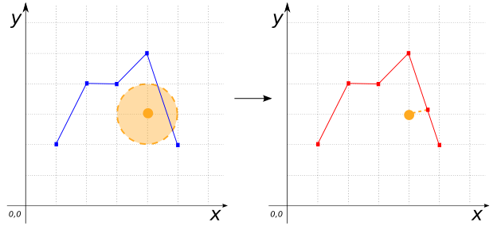
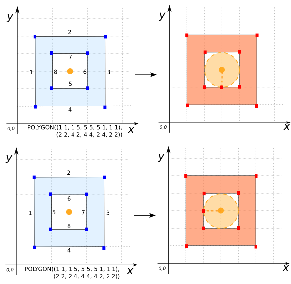

# ST_InsertPoint

## Signatures

```sql
GEOMETRY ST_InsertPoint(GEOMETRY geom, POINT point);
GEOMETRY ST_InsertPoint(GEOMETRY geom, POINT point, DOUBLE tolerance);
```

## Description

Inserts `point` as a new vertex of `geom`, by snapping it on the nearest segment of `geom` if it is within a distance of `tolerance`. If no `tolerance` is given, a default of `10E-6` is used.

If there are several segments at the same minimal distance, `point` is snapped on the first one found, so the result depends on the order of the coordinates of `geom`.

Depending on the type of `geom`:

* `POINT`, `GEOMETRYCOLLECTION`: an error is thrown,
* `MULTIPOINT`: `point` is added to the points (`tolerance` is not used),
* `LINESTRING`, `MULTILINESTRING`: `point` is snapped on the nearest segment,
* `POLYGON`, `MULTIPOLYGON`: `point` is snapped on a hole if it is within `tolerance` of this hole, on the exterior ring otherwise.

`geom` is returned unchanged if `point` is farther than `tolerance`. For a `LINESTRING`, `NULL` is returned if the snapped point is already a vertex of `geom`.

Returns `NULL` if `geom` or `point` is `NULL`, and `geom` if one of them is empty. An error is thrown if `geom` and `point` have different SRIDs, or if the result is an invalid `POLYGON`.

:::{note}
To add a vertex at a given position of a `LINESTRING`, without snapping, use [`ST_AddPoint`](../ST_AddPoint).
:::

## Examples

```sql
SELECT ST_InsertPoint('POINT(0 0)', 'POINT(1 1)');
-- Answer: Cannot insert a point on  : Point
```

```sql
SELECT ST_InsertPoint('MULTIPOINT((0 0), (3 3))', 'POINT(1 1)');
-- Answer: MULTIPOINT((0 0), (3 3), (1 1))
```

```sql
SELECT ST_InsertPoint('LINESTRING(1 2, 2 4, 3 4, 4 5, 5 2)',
                      'POINT(4 3)', 1);
-- Answer: LINESTRING(1 2, 2 4, 3 4, 4 5, 4.6 3.2, 5 2)
```

{align=center}

```sql
SELECT ST_InsertPoint('LINESTRING(1 2, 2 4, 3 4, 4 5, 5 2)',
                      'POINT(4 3)');
-- Answer: LINESTRING(1 2, 2 4, 3 4, 4 5, 5 2)
```

Note: The point added depends on the input geometry's coordinate order.

```sql
SELECT ST_InsertPoint('POLYGON((1 1, 1 5, 5 5, 5 1, 1 1),
                               (2 2, 4 2, 4 4, 2 4, 2 2))',
                      'POINT(3 3)', 1);
-- Answer: POLYGON((1 1, 1 5, 5 5, 5 1, 1 1),
--                 (2 2, 3 2, 4 2, 4 4, 2 4, 2 2))
```

```sql
SELECT ST_InsertPoint('POLYGON((1 1, 1 5, 5 5, 5 1, 1 1),
                               (2 2, 2 4, 4 4, 4 2, 2 2))',
                      'POINT(3 3)', 1);
-- Answer: POLYGON((1 1, 1 5, 5 5, 5 1, 1 1),
--                 (2 2, 2 3, 2 4, 4 4, 4 2, 2 2))
```

{align=center}

```sql
CREATE TABLE input(poly GEOMETRY(POLYGON), p GEOMETRY(POINT));
INSERT INTO input VALUES ('POLYGON((1 1, 1 5, 5 5, 5 1, 1 1),
                                   (2 2, 4 2, 4 4, 2 4, 2 2))',
                          'POINT(3 3)');

SELECT ST_InsertPoint(poly, p, 0.5) FROM input;
-- Answer: POLYGON((1 1, 1 5, 5 5, 5 1, 1 1),
--                 (2 2, 4 2, 4 4, 2 4, 2 2))
```

Note: In the next two examples, the result is the same regardless of the tolerance.

```sql
SELECT ST_InsertPoint(poly, p, 1) FROM input;
-- Answer: POLYGON((1 1, 1 5, 5 5, 5 1, 1 1),
--                 (2 2, 3 2, 4 2, 4 4, 2 4, 2 2))
```

```sql
SELECT ST_InsertPoint(poly, p, 2) FROM input;
-- Answer: POLYGON((1 1, 1 5, 5 5, 5 1, 1 1),
--                 (2 2, 3 2, 4 2, 4 4, 2 4, 2 2))
```

## See also

* [`ST_AddPoint`](../ST_AddPoint), [`ST_RemovePoints`](../ST_RemovePoints), [`ST_Densify`](../ST_Densify)
* <a href="https://github.com/orbisgis/h2gis/blob/master/h2gis-functions/src/main/java/org/h2gis/functions/spatial/edit/ST_InsertPoint.java" target="_blank">Source code</a>
