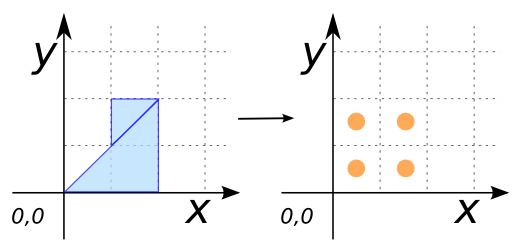

# ST_MakeGridPoints

## Signatures

```sql
TABLE[THE_GEOM, ID, ID_COL, ID_ROW]
    ST_MakeGridPoints(GEOMETRY geom, DOUBLE deltaX, DOUBLE deltaY);
TABLE[THE_GEOM, ID, ID_COL, ID_ROW]
    ST_MakeGridPoints(VARCHAR tableName, DOUBLE deltaX, DOUBLE deltaY);
TABLE[THE_GEOM, ID, ID_COL, ID_ROW]
    ST_MakeGridPoints(GEOMETRY geom, DOUBLE deltaX, DOUBLE deltaY, DOUBLE angle);
TABLE[THE_GEOM, ID, ID_COL, ID_ROW]
    ST_MakeGridPoints(VARCHAR tableName, DOUBLE deltaX, DOUBLE deltaY, DOUBLE angle);
TABLE[THE_GEOM, ID, ID_COL, ID_ROW]
    ST_MakeGridPoints(GEOMETRY geom, DOUBLE deltaX, DOUBLE deltaY, BOOLEAN upperOrder);
TABLE[THE_GEOM, ID, ID_COL, ID_ROW]
    ST_MakeGridPoints(VARCHAR tableName, DOUBLE deltaX, DOUBLE deltaY, BOOLEAN upperOrder);
TABLE[THE_GEOM, ID, ID_COL, ID_ROW]
    ST_MakeGridPoints(GEOMETRY geom, DOUBLE deltaX, DOUBLE deltaY, BOOLEAN upperOrder, DOUBLE angle);
TABLE[THE_GEOM, ID, ID_COL, ID_ROW]
    ST_MakeGridPoints(VARCHAR tableName, DOUBLE deltaX, DOUBLE deltaY, BOOLEAN upperOrder, DOUBLE angle);
TABLE[THE_GEOM, ID, ID_COL, ID_ROW]
    ST_MakeGridPoints(GEOMETRY geom, DOUBLE deltaX, DOUBLE deltaY, BOOLEAN upperOrder, BOOLEAN isColumnsRowsMeasure);
TABLE[THE_GEOM, ID, ID_COL, ID_ROW]
    ST_MakeGridPoints(VARCHAR tableName, DOUBLE deltaX, DOUBLE deltaY, BOOLEAN upperOrder, BOOLEAN isColumnsRowsMeasure);
TABLE[THE_GEOM, ID, ID_COL, ID_ROW]
    ST_MakeGridPoints(GEOMETRY geom, DOUBLE deltaX, DOUBLE deltaY, BOOLEAN upperOrder, BOOLEAN isColumnsRowsMeasure, DOUBLE angle);
TABLE[THE_GEOM, ID, ID_COL, ID_ROW]
    ST_MakeGridPoints(VARCHAR tableName, DOUBLE deltaX, DOUBLE deltaY, BOOLEAN upperOrder, BOOLEAN isColumnsRowsMeasure, DOUBLE angle);
```

## Description

Calculates a regular grid of `POINT`s based on a single Geometry
`geom` or a table `tableName` of Geometries with `deltaX` and
`deltaY` as offsets in the Cartesian plane.
Each point is located at the center of a cell: with the same arguments,
`ST_MakeGridPoints` returns the centroids of the cells computed by
[`ST_MakeGrid`](../ST_MakeGrid), with the same `ID`, `ID_COL` and `ID_ROW`.

There are three optional parameters :
* `upperOrder` : A boolean, set to true indicates to start the cell from the upper left corner,
* `isColumnsRowsMeasure` : A boolean, set to true indicates that the delta x and delta y defines the number of columns and rows,
* `angle` : A double, the angle of grid rotation *(expressed in radian)*. The grid is rotated counterclockwise around the center of the input envelope.

## Examples

### Using a Geometry

```sql
CREATE TABLE grid AS SELECT * FROM
    ST_MakeGridPoints('POLYGON((0 0, 2 0, 2 2, 0 0))'::GEOMETRY, 1, 1);
SELECT * FROM grid;
```

Answer:
|    THE_GEOM     |  ID | ID_COL | ID_ROW |
| --------------- | --- | ------ | ------ |
| POINT(0.5 0.5)  |   0 |      1 |      1 |
| POINT(1.5 0.5)  |   1 |      2 |      1 |
| POINT(0.5 1.5)  |   2 |      1 |      2 |
| POINT(1.5 1.5)  |   3 |      2 |      2 |

### Using a table

```sql
CREATE TABLE TEST(THE_GEOM GEOMETRY);
INSERT INTO TEST VALUES ('POLYGON((0 0, 2 0, 2 2, 0 0))');
CREATE TABLE grid AS SELECT * FROM
    ST_MakeGridPoints('TEST', 1, 1);
SELECT * FROM grid;
```

Answer:
|    THE_GEOM     |  ID | ID_COL | ID_ROW |
| --------------- | --- | ------ | ------ |
| POINT(0.5 0.5)  |   0 |      1 |      1 |
| POINT(1.5 0.5)  |   1 |      2 |      1 |
| POINT(0.5 1.5)  |   2 |      1 |      2 |
| POINT(1.5 1.5)  |   3 |      2 |      2 |

### Using a subquery to construct a Geometry

```sql
CREATE TABLE TEST2(THE_GEOM GEOMETRY);
INSERT INTO TEST2 VALUES
    ('POLYGON((0 0, 2 0, 2 2, 0 0))'),
    ('POLYGON((1 1, 2 2, 1 2, 1 1))');
CREATE TABLE grid AS SELECT * FROM
    ST_MakeGridPoints(
        (SELECT ST_Union(ST_Accum(THE_GEOM)) FROM TEST2), 1, 1);
SELECT * FROM grid;
```

Answer:
|    THE_GEOM     |  ID | ID_COL | ID_ROW |
| --------------- | --- | ------ | ------ |
| POINT(0.5 0.5)  |   0 |      1 |      1 |
| POINT(1.5 0.5)  |   1 |      2 |      1 |
| POINT(0.5 1.5)  |   2 |      1 |      2 |
| POINT(1.5 1.5)  |   3 |      2 |      2 |

{align=center}

### Start from the upper left corner

```sql
CREATE TABLE grid AS SELECT * FROM
    ST_MakeGridPoints('POLYGON((0 0, 2 0, 2 2, 0 0))'::GEOMETRY, 1, 1, true);
SELECT * FROM grid;
```

Answer:
|    THE_GEOM     |  ID | ID_COL | ID_ROW |
| --------------- | --- | ------ | ------ |
| POINT(0.5 1.5)  |   0 |      1 |      1 |
| POINT(1.5 1.5)  |   1 |      2 |      1 |
| POINT(0.5 0.5)  |   2 |      1 |      2 |
| POINT(1.5 0.5)  |   3 |      2 |      2 |

### Using a number of columns and rows

`deltaX` and `deltaY` define 4 columns and 2 rows.

```sql
CREATE TABLE grid AS SELECT * FROM
    ST_MakeGridPoints('POLYGON((0 0, 2 0, 2 2, 0 0))'::GEOMETRY, 4, 2, false, true);
SELECT * FROM grid;
```

Answer:
|    THE_GEOM      |  ID | ID_COL | ID_ROW |
| ---------------- | --- | ------ | ------ |
| POINT(0.25 0.5)  |   0 |      1 |      1 |
| POINT(0.75 0.5)  |   1 |      2 |      1 |
| POINT(1.25 0.5)  |   2 |      3 |      1 |
| POINT(1.75 0.5)  |   3 |      4 |      1 |
| POINT(0.25 1.5)  |   4 |      1 |      2 |
| POINT(0.75 1.5)  |   5 |      2 |      2 |
| POINT(1.25 1.5)  |   6 |      3 |      2 |
| POINT(1.75 1.5)  |   7 |      4 |      2 |

### Compute a grid with a rotation (angle in radians)

```sql
CREATE TABLE grid AS SELECT * FROM
    ST_MakeGridPoints('POLYGON((0 0, 2 0, 2 2, 0 0))'::GEOMETRY, 1, 1, RADIANS(45));
SELECT * FROM grid;
```

Answer:
|      THE_GEOM        |  ID | ID_COL | ID_ROW |
| -------------------- | --- | ------ | ------ |
| POINT(1 -0.293)      |   0 |      1 |      1 |
| POINT(1.707 0.414)   |   1 |      2 |      1 |
| POINT(2.414 1.121)   |   2 |      3 |      1 |
| POINT(0.293 0.414)   |   3 |      1 |      2 |
| POINT(1 1.121)       |   4 |      2 |      2 |
| POINT(1.707 1.828)   |   5 |      3 |      2 |

## See also

* [`ST_MakeGrid`](../ST_MakeGrid)
* <a href="https://github.com/orbisgis/h2gis/blob/master/h2gis-functions/src/main/java/org/h2gis/functions/spatial/create/ST_MakeGridPoints.java" target="_blank">Source code</a>