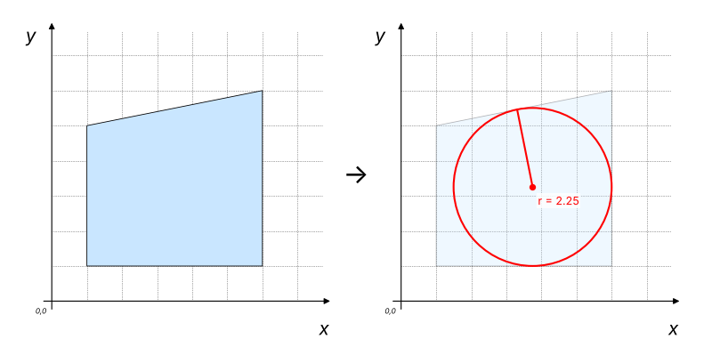
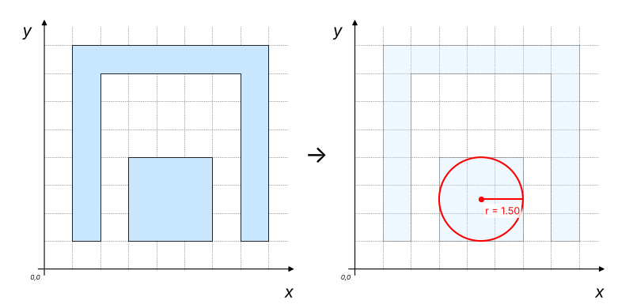
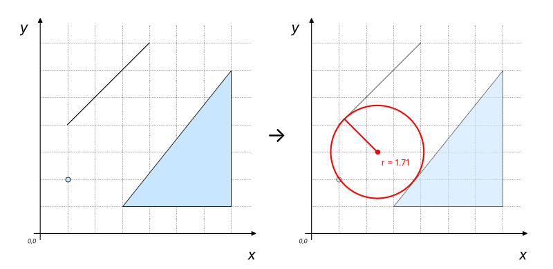

# ST_MaximumInscribedCircleRadius

## Signature

```sql
DOUBLE ST_MaximumInscribedCircleRadius(the_geomETRY the_geom);
```

## Description

Returns the radius of the circle computed by [`ST_MaximumInscribedCircle`](../ST_MaximumInscribedCircle):

* if `the_geom` is a `POLYGON` or a `MULTIPOLYGON`, the radius of the largest circle contained within `the_geom`,
* otherwise, the radius of the largest empty circle for the set of obstacles `the_geom` (any combination of points, lines and polygons). The center of this circle is inside the convex hull of `the_geom`, and the circle does not contain any obstacle.

The radius is computed with a tolerance equal to 1/1000 of the largest side of the envelope of `the_geom`, so the result is an approximation within this tolerance.

Returns `NULL` if `the_geom` is `NULL` or empty.

:::{note}
`ST_MaximumInscribedCircleRadius(the_geom)` is equivalent to the radius of `ST_MaximumInscribedCircle(the_geom)`, without building the circle. It is based on the JTS `MaximumInscribedCircle` and `LargestEmptyCircle` algorithms.
:::

In the examples below, the results are rounded to 2 decimals.

## Examples

### With `POLYGON`

```sql
SELECT ST_MaximumInscribedCircleRadius('POLYGON((1 1, 6 1, 6 6, 1 5, 1 1))');
-- Answer: 2.25
```

{align=center}

```sql
SELECT ST_MaximumInscribedCircleRadius('POLYGON((190 390, 100 210, 267 125,
                                                360 280, 190 390))');
-- Answer: 95.34
```

### With `MULTIPOLYGON`

The radius is the one of the largest circle among all the polygons. The area of a polygon is not sufficient, its shape matters: here, the circle is in the small square and not in the large but narrow polygon.

```sql
SELECT ST_MaximumInscribedCircleRadius('MULTIPOLYGON(((3 1, 6 1, 6 4, 3 4, 3 1)),
                    ((1 1, 2 1, 2 7, 7 7, 7 1, 8 1, 8 8, 1 8, 1 1)))');
-- Answer: 1.50
```

{align=center}

### With obstacles

With a `the_geomETRYCOLLECTION`, the the_geometries are obstacles that the circle cannot contain:

```sql
SELECT ST_MaximumInscribedCircleRadius('the_geomETRYCOLLECTION(
                        POINT(1 2),
                        LINESTRING(1 4, 4 7),
                        POLYGON((3 1, 7 1, 7 6, 3 1)))');
-- Answer: 1.71
```

{align=center}

```sql
SELECT ST_MaximumInscribedCircleRadius('MULTILINESTRING((79.5 364, 183.5 280),
                                                        (70 220, 166 333),
                                                        (130.5 242.5, 193.5 243))');
-- Answer: 49.70
```

### With an empty the_geometry

```sql
SELECT ST_MaximumInscribedCircleRadius('POLYGON EMPTY');
-- Answer: NULL
```

## See also

* [`ST_MaximumInscribedCircle`](../ST_MaximumInscribedCircle), [`ST_BoundingCircle`](../ST_BoundingCircle), [`ST_MinimumDiameter`](../ST_MinimumDiameter)
* <a href="https://github.com/orbisgis/h2gis/blob/master/h2gis-functions/src/main/java/org/h2gis/functions/spatial/create/ST_MaximumInscribedCircleRadius.java" target="_blank">Source code</a>
