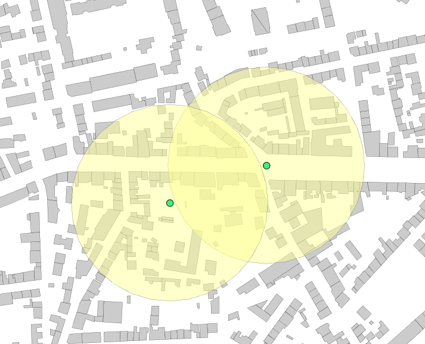
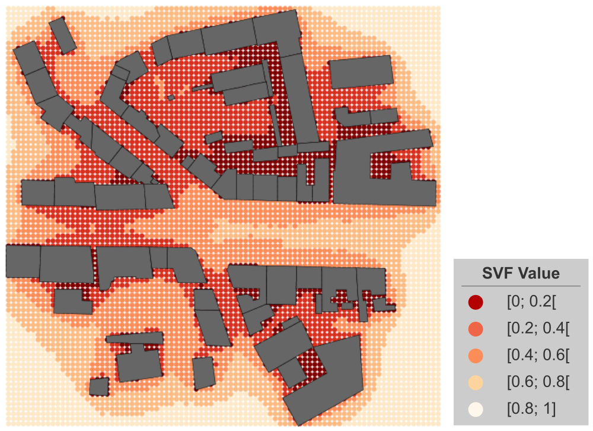
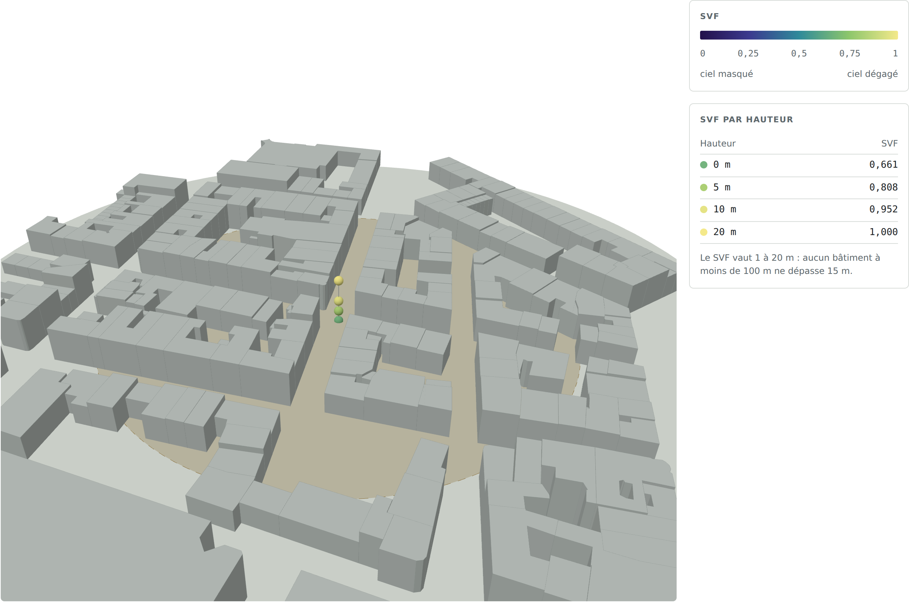

# ST_SVF

## Signature

```sql
DOUBLE ST_SVF(GEOMETRY point, GEOMETRY geoms, DOUBLE distance, 
              INTEGER rayCount)
DOUBLE ST_SVF(GEOMETRY point, GEOMETRY geoms, DOUBLE distance, 
              INTEGER rayCount, ARRAY heights)
```

## Description

Compute the Sky View Factor for a given point based on geometries where:

* `point` : Point coordinates (x, y, z) from which the SVF will be calculated,
* `geoms` : Geometry or set of geometries grouped into a simple or complex geometry, used as sky obstacles *(z coordinates should be given and not NaN)*,
* `distance` : Only obstacles located within this distance from the `point` are considered in the calculation *(exprimed in meters)*,
* `rayCount` : Number of ray considered for the calculation *(number of direction of calculation)*,
* `heights` : Array of observer heights relative to the z of the point (0 if the point is 2D).


## Examples

### Case with one entry point

Creation of the table with one point (here expressed in Lambert 93, French system - EPSG:2154)

```sql
DROP TABLE IF EXISTS POINT;
CREATE TABLE POINT AS SELECT ('POINT(222821.90377044567 6757577.12494107)'::GEOMETRY) as the_geom;
```

Computation of the SVF with:

* BUILDING : table with buildings used as obstacles
* Distance fixed to 100m
* Number of rays fixed to 150

```sql
DROP TABLE IF EXISTS SVF;
CREATE TABLE SVF AS 
   SELECT ST_SVF(a.THE_GEOM, ST_ACCUM(b.THE_GEOM), 100, 150) AS SVF 
   FROM POINT a, BUILDING b;

-- Answer: 
|        SVF         |
|--------------------|
| 0.5658633540674807 |
```

### Case with two entry points

```sql
-- Add a second point to compute the SVF
INSERT INTO POINT VALUES ('POINT(222723.6455 6757539.0997)'::GEOMETRY);

-- Compute the SVF for both points
DROP TABLE IF EXISTS SVF;
CREATE TABLE SVF AS 
   SELECT ST_SVF(a.THE_GEOM, ST_ACCUM(b.THE_GEOM), 100, 150) AS SVF 
   FROM POINT a, BUILDING b GROUP BY a.the_geom;

-- Answer: 
|        SVF         |
|--------------------|
| 0.5658633540674807 |
| 0.4826031275651395 |
```

{align=center}


### Case with a grid of entry points

In the example below, we are using a grid of points to compute SVFs. The grid is built using a table of buildings.

```sql
DROP TABLE IF EXISTS env, grid, grid_points;
-- Generate the envelope of all buildings
CREATE TABLE env AS 
   SELECT ST_Envelope(ST_Accum(THE_GEOM)) AS THE_GEOM FROM BUILDINGS;
-- Generate a regular grid of 2 meters on the basis of the envelope
CREATE TABLE grid AS 
   SELECT * FROM ST_MakeGrid('env', 2, 2);
-- Retrieve the centroid points of all grid cells
CREATE TABLE grid_points AS 
   SELECT ST_Centroid(THE_GEOM) AS THE_GEOM FROM grid;
-- Add a serial column in order to have a point id
ALTER TABLE GRID_POINTS ADD COLUMN id bigint auto_increment;

-- Compute the SVF on all these points (keeping id and geometry)
-- Using all buildings that are within 50m around a point
DROP TABLE IF EXISTS SVF;
CREATE TABLE SVF AS SELECT a.THE_GEOM, a.ID, 
   ST_SVF(a.THE_GEOM, ST_ACCUM(b.THE_GEOM), 50, 100) AS SVF 
   FROM GRID_POINTS a, BUILDINGS b GROUP BY a.THE_GEOM;

-- Answer: Table "SVF"
|  THE_GEOM  | ID |        SVF         |
|------------|----|--------------------|
| POINT(...) | 1  | 0.5658633540674807 |
| POINT(...) | 2  | 0.4826031275651395 |
| POINT(...) | 4  | 0.9134765374639576 |
| POINT(...) | 5  | 0.2521816420649933 |
...
| POINT(...) | n  | 0.4547755583760515 |

```

{align=center}


### Case with heights

```sql
SELECT p.THE_GEOM,
       ST_SVF(p.THE_GEOM, ST_ACCUM(ST_UPDATEZ(b.the_geom, b.HEIGHT_WALL)), 100, 60, ARRAY[0, 5, 10, 20]) AS SVF
FROM svf_point p, building b
WHERE ST_EXPAND(p.THE_GEOM, 100) && b.the_geom AND ST_DWITHIN(b.the_geom, p.THE_GEOM, 100)
GROUP BY p.THE_GEOM;

-- To save one 3D point per height: z = height, with the SVF at that height.
-- Note : The VALUES list must contain the same heights, in the same order, as the ARRAY above
CREATE TABLE svf_3d AS SELECT 
        ST_SETSRID(ST_MAKEPOINT(ST_X(s.THE_GEOM), ST_Y(s.THE_GEOM), h.HEIGHT), ST_SRID(s.THE_GEOM)) AS THE_GEOM,
        h.HEIGHT, s.SVF[h.RANK] AS SVF 
FROM svf s, (VALUES (1, 0.0), (2, 5.0), (3, 10.0), (4, 20.0)) AS h(RANK, HEIGHT);

--Save it
CALL FGBWRITE('/tmp/svf_3d.fgb', 'svf_3d', true)
    
-- Answer: 
| THE_GEOM | HEIGHT | SVF |
|---|---|---|
| POINT (472961.44243117847 5288354.396065518) | 0.0 | 0.6615 |
| POINT (472961.44243117847 5288354.396065518) | 5.0 | 0.8083 |
| POINT (472961.44243117847 5288354.396065518) | 10.0 | 0.9522 |
| POINT (472961.44243117847 5288354.396065518) | 20.0 | 1.0000 |
```
{align=center}
Data represented with [three.js](https://threejs.org/)

## See also

* [`ST_SunPosition`](../ST_SunPosition), [`ST_ISOVist`](../ST_ISOVist)
* <a href="https://github.com/orbisgis/h2gis/blob/master/h2gis-functions/src/main/java/org/h2gis/functions/spatial/earth/ST_Svf.java" target="_blank">Source code</a>
