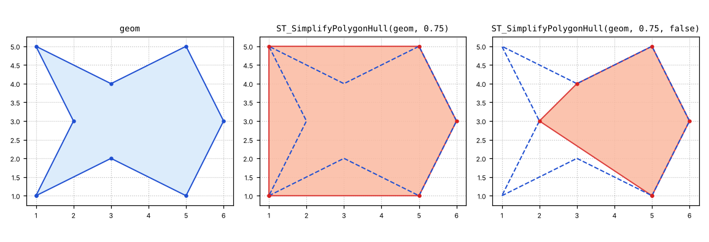
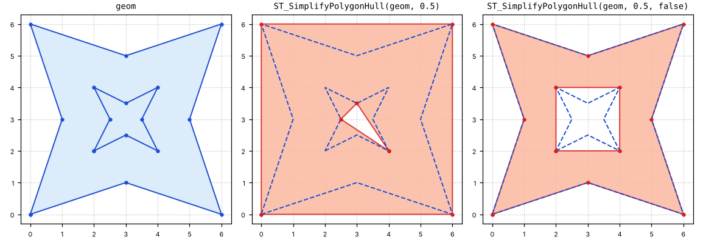
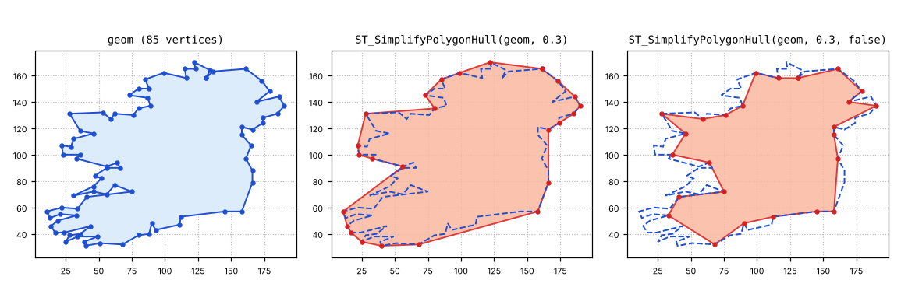

# ST_SimplifyPolygonHull

## Signatures

```sql
GEOMETRY ST_SimplifyPolygonHull(GEOMETRY the_geom, DOUBLE vertexNumFraction);
GEOMETRY ST_SimplifyPolygonHull(GEOMETRY the_geom, DOUBLE vertexNumFraction, BOOLEAN isOuter);
```

## Description

Computes a simplified hull of the polygonal geometry `the_geom`, that preserves its topology.

* The outer hull (`isOuter` = `true`, the default value) contains `geom`: its area is larger.
* The inner hull (`isOuter` = `false`) is contained by `geom`: its area is smaller.

`vertexNumFraction` is the fraction of the vertices of `geom` kept in the result, between `0` and `1`:

* `1` returns `the_geom`,
* smaller values produce simpler and less concave hulls,
* `0` returns the convex hull for an outer hull (with triangles for the holes), and a triangle for an inner hull.


Returns `NULL` if `the_geom` is `NULL`. An error is thrown if `the_geom` is not a `POLYGON` or a `MULTIPOLYGON`.

The SRID of `the_geom` is kept.

:::{note}
`ST_SimplifyPolygonHull` is based on the JTS [`PolygonHullSimplifier`](https://locationtech.github.io/jts/javadoc/org/locationtech/jts/simplify/PolygonHullSimplifier.html). Unlike [`ST_SimplifyPreserveTopology`](../ST_SimplifyPreserveTopology), the result is guaranteed to contain (outer hull) or to be contained by (inner hull) the input geometry.
:::

## Examples

### Outer and inner hulls

```sql
SELECT ST_SimplifyPolygonHull('POLYGON((1 1, 3 2, 5 1, 6 3, 5 5,
                                        3 4, 1 5, 2 3, 1 1))', 0.75);
-- Answer: POLYGON((1 1, 1 5, 5 5, 6 3, 5 1, 1 1))
```

```sql
SELECT ST_SimplifyPolygonHull('POLYGON((1 1, 3 2, 5 1, 6 3, 5 5,
                                        3 4, 1 5, 2 3, 1 1))', 0.75, false);
-- Answer: POLYGON((5 1, 6 3, 5 5, 3 4, 2 3, 5 1))
```

{align=center}

### With `vertexNumFraction` equal to `0` or `1`

With `0`, the outer hull is the convex hull:

```sql
SELECT ST_SimplifyPolygonHull('POLYGON((1 1, 3 2, 5 1, 6 3, 5 5,
                                        3 4, 1 5, 2 3, 1 1))', 0);
-- Answer: POLYGON((1 1, 1 5, 5 5, 6 3, 5 1, 1 1))
```

With `1`, the input geometry is returned:

```sql
SELECT ST_SimplifyPolygonHull('POLYGON((1 1, 3 2, 5 1, 6 3, 5 5,
                                        3 4, 1 5, 2 3, 1 1))', 1);
-- Answer: POLYGON((1 1, 3 2, 5 1, 6 3, 5 5, 3 4, 1 5, 2 3, 1 1))
```

### With a hole

The outer hull makes the hole smaller, the inner hull makes it larger:

```sql
SELECT ST_SimplifyPolygonHull('POLYGON((0 0, 3 1, 6 0, 5 3, 6 6, 3 5, 0 6, 1 3, 0 0),
               (2 2, 3 2.5, 4 2, 3.5 3, 4 4, 3 3.5, 2 4, 2.5 3, 2 2))', 0.5);
-- Answer: POLYGON((0 0, 0 6, 6 6, 6 0, 0 0),
--                 (4 2, 3 3.5, 2.5 3, 4 2))
```

```sql
SELECT ST_SimplifyPolygonHull('POLYGON((0 0, 3 1, 6 0, 5 3, 6 6, 3 5, 0 6, 1 3, 0 0),
               (2 2, 3 2.5, 4 2, 3.5 3, 4 4, 3 3.5, 2 4, 2.5 3, 2 2))', 0.5, false);
-- Answer: POLYGON((0 0, 3 1, 6 0, 5 3, 6 6, 3 5, 0 6, 1 3, 0 0),
--                 (2 2, 2 4, 4 4, 4 2, 2 2))
```

{align=center}

### With a complex polygon

With `0.3`, the hulls of this polygon of 85 vertices keep 25 vertices:

```sql
CREATE TABLE input AS SELECT 'POLYGON((131 158, 136 163, 161 165, 173 156, 179 148, 169 140,
    186 144, 190 137, 185 131, 174 128, 174 124, 166 119, 158 121, 158 115, 165 107,
    161 97, 166 88, 166 79, 158 57, 145 57, 112 53, 111 47, 93 43, 90 48, 88 40, 80 39,
    68 32, 51 33, 40 31, 39 34, 49 38, 34 38, 25 34, 28 39, 36 40, 44 46, 24 41, 17 41,
    14 46, 19 50, 33 54, 21 55, 13 52, 11 57, 22 60, 34 59, 41 68, 75 72, 62 77, 56 70,
    46 72, 31 69, 46 76, 52 82, 47 84, 56 90, 66 90, 64 94, 56 91, 33 97, 36 100, 23 100,
    22 107, 29 106, 31 112, 46 116, 36 118, 28 131, 53 132, 59 127, 62 131, 76 130,
    80 135, 89 137, 87 143, 73 145, 80 150, 88 150, 85 157, 99 162, 116 158, 115 165,
    123 165, 122 170, 134 164, 131 158))'::GEOMETRY AS the_geom;

SELECT ST_NPoints(the_geom) AS input,
       ST_NPoints(ST_SimplifyPolygonHull(the_geom, 0.3)) AS outer_hull,
       ST_NPoints(ST_SimplifyPolygonHull(the_geom, 0.3, false)) AS inner_hull
FROM input;
```

| INPUT | OUTER_HULL | INNER_HULL |
|:-----:|:----------:|:----------:|
| 86    | 26         | 26         |

`ST_NPoints` also counts the last point of the ring, which closes it.

{align=center}

### With a `LINESTRING`

```sql
SELECT ST_SimplifyPolygonHull('LINESTRING(5 125, 38 51, 39 52.4, 118 115)', 0.3);
-- Answer: Error, the input geometry must be polygonal
```

## See also

* [`ST_ConcaveHull`](../ST_ConcaveHull), [`ST_ConvexHull`](../ST_ConvexHull), [`ST_SimplifyPreserveTopology`](../ST_SimplifyPreserveTopology), [`ST_SimplifyVW`](../ST_SimplifyVW)
* <a href="https://github.com/orbisgis/h2gis/blob/master/h2gis-functions/src/main/java/org/h2gis/functions/spatial/generalize/ST_SimplifyPolygonHull.java" target="_blank">Source code</a>
